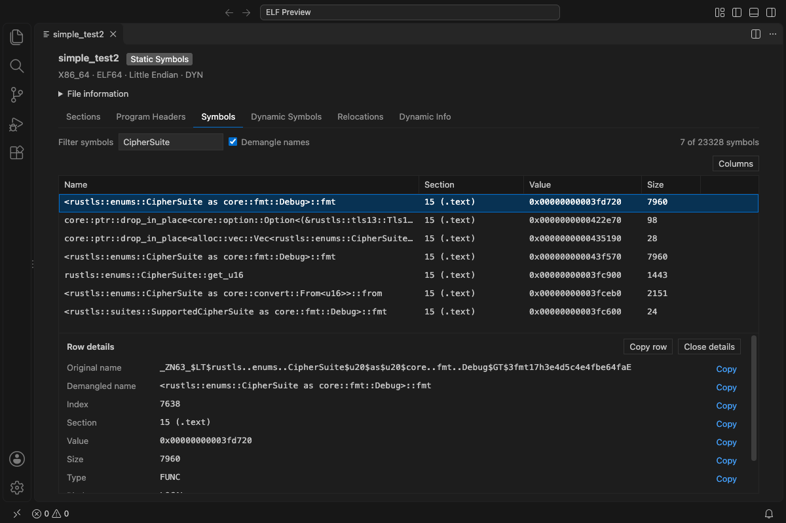
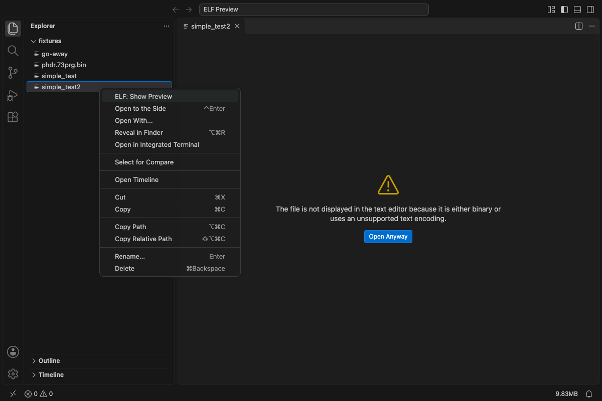
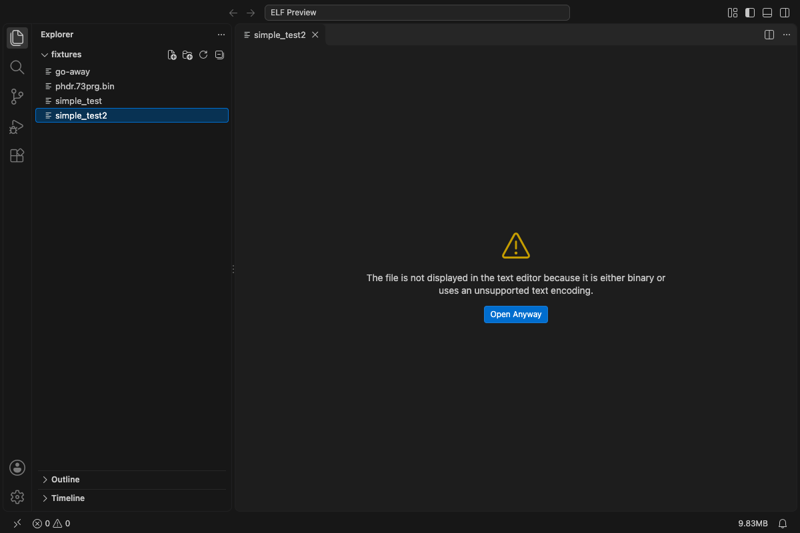
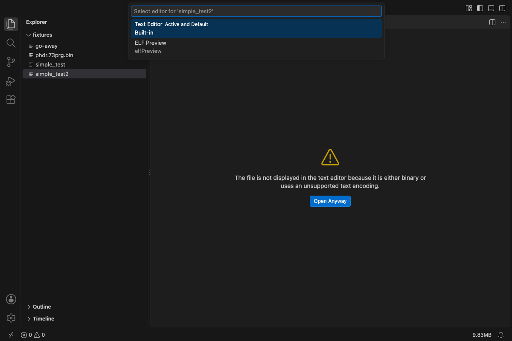
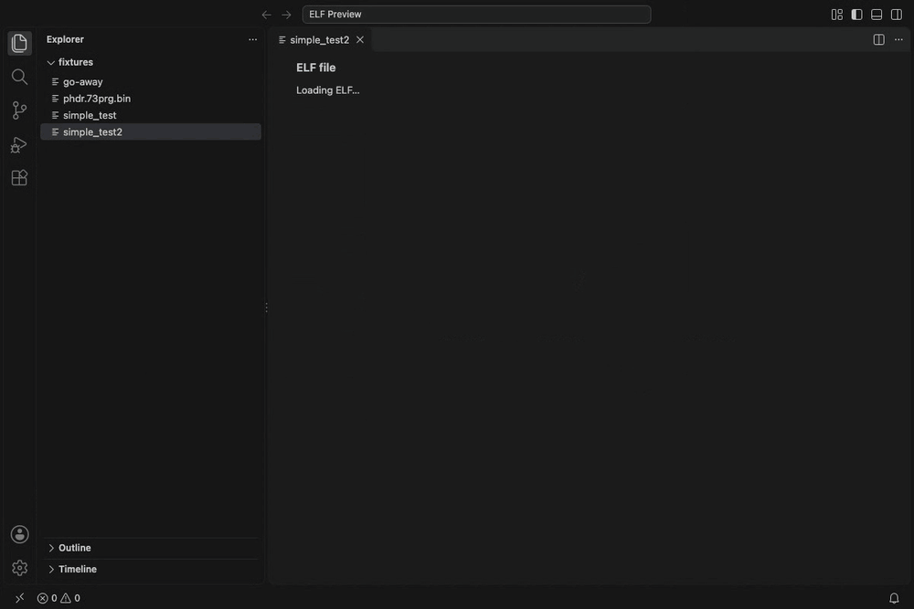

# elfpreview

A lightweight VS Code extension that provides d information about ELF files in a clean, no-frills webview-based interface. Combining features similar to `readelf` and `file`, it uses a modern stack to offer a fast and clean experience.

The extention adds an aditional editor, similar to how a hex editor might work, which is used to display a table view of information about the currenly open file.



## Table of Contents

- [Overview](#overview)
- [Features](#features)
- [Installation](#installation)
- [Usage](#usage)
- [Extension Settings](#extension-settings)
- [Known Issues](#known-issues)
- [Release Notes](#release-notes)
- [Background](#background)

## Overview

This extension is designed to analyze ELF files by:

- Extracting key information in a manner similar to traditional command line tools.

- Presenting a detailed webview with a simple, efficient UI built with Svelte 5.

- Handling binaries up to 64 MiB, with reports limited to 250,000 records and 32 MiB of text, and virtualized tables for large symbol lists.

It is implemented using a combination of Rust (via the [libgoblin](https://github.com/m4b/goblin) library running in WebAssembly) and TypeScript. The parser is a core WebAssembly module built for `wasm32-unknown-unknown`, with [WIT types](https://component-model.bytecodealliance.org/design/wit.html) and canonical ABI bindings. It has no WASI imports and is not a packaged WebAssembly component.

## Features

- **File Analysis**: Shows a loading state while a worker parses the file, then displays the complete result.

- **Detailed Parsing**: Processing of ELF binaries, even those with extensive symbols, done in the background to reduce felt lag.

- **No-Frills UI**: A straightforward, functional webview that just works, no unnecessary complexity.

- **Desktop & Remote Extension Hosts**: Uses a Node extension host on macOS, Windows, or Linux. It does not run as a browser-only VS Code extension.

## Installation

1. **From the VS Code Marketplace:** Search for `elfpreview` in the Extensions view and install it directly: [marketplace.visualstudio.com/elfpreview](https://marketplace.visualstudio.com/items?itemName=jlevere.elfpreview)

2. **Via VSIX:** Download the provided `.vsix` file from [elfpreview/releases](https://github.com/jlevere/elfpreview/releases) and install it by running

```bash
code --install-extension elfpreview-<release>.vsix
```

## Usage

Open an ELF file with the [Context Menu](#context-menu) or [Editor Selection](#editor-selection).

### Context Menu

Simply right click on an elf binary and select `ELF: Show Preview`



### Editor Selection

Opening a binary in the text editor may show an unsupported encoding message.



Choose **Open Anyway**, then select **ELF Preview** from the editor picker.



Filter symbols by their original or demangled names, enable **Demangle names** for readable Rust and Itanium C++ names, and use **Columns** to choose which fields to show. Drag a column boundary to resize it.

Click a row to inspect all of its fields, including hidden columns. Copy an individual value or the complete row; original symbol names remain available alongside demangled names. Arrow keys, Page Up/Down and Home/End browse rows, Enter opens details, and Escape closes them.



## Extension Settings

There are no settings for this extension

## Known Issues

- `pnpm generate:wit` applies a bounded workaround for namespace errors in `wit2ts` 1.0.2; `pnpm check:generated` verifies the committed bindings.

If you experence any other issues, please submit an issue here: [elfpreview/issues](https://github.com/jlevere/elfpreview/issues)

## Release Notes

### 0.1.1

Added more information about symbols

### 0.1.0

Initial release

## Background

How files are processed:

1. Initial Display: Upon opening an ELF file, the extension shows a loading state.

2. Background Processing: Each custom document owns one parse job in a Node worker:

   - The file is read through VS Code’s filesystem API and transferred to the worker.

   - The Rust-based parser (using libgoblin) processes the file.

   - The worker returns one typed result; views receive it after a ready handshake. Closing the document cancels unfinished parsing; filesystem reads already in progress finish through VS Code’s API.

3. Communication: Type sharing between TypeScript and WebAssembly uses WIT and canonical ABI bindings, with stubs generated using [Microsoft's wit2ts tool](https://github.com/microsoft/vscode-wasm/blob/main/wasm-component-model/bin/wit2ts).

## Tests

The Rust tests are in [tests.rs](./rust/src/tests.rs). They use a few test files in the [fixtures](./rust/tests/fixtures/) directory. Some of these test binaries were taken from [https://github.com/tmpout/elfs](https://github.com/tmpout/elfs), primarily made by [@netspooky](https://x.com/netspooky)

Some have strange architectures, some lots of headers, etc. The one that actually gave pause was a simple rust program compiled with symbols in a nix enviroment. Turns out it has several hundered symbols with massively long names which is a struggle to push through the ts wasm boundary and also just to display cleanly.
